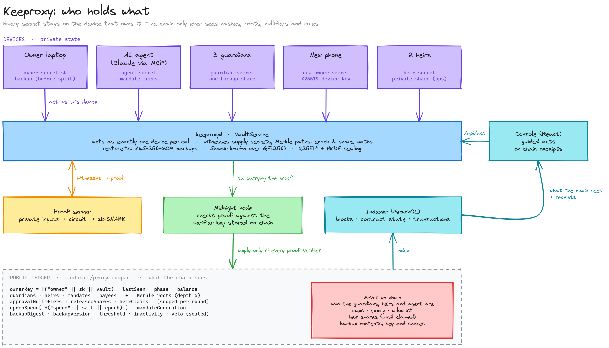
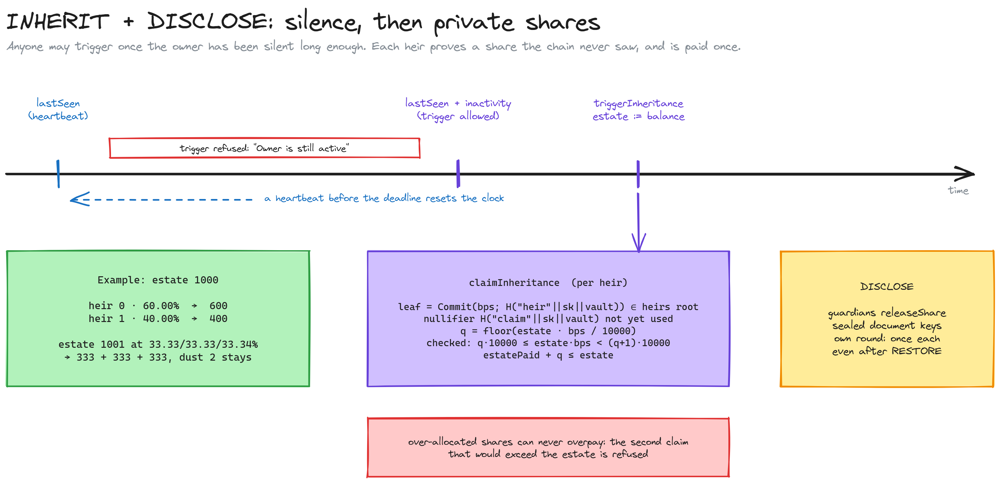

<div align="center">

# keeproxy

**Who can act for you when you can't.**

A whole-life vault on Midnight. Your AI agent, your guardians and your heirs act on your behalf,
within limits a zero-knowledge contract enforces, without the chain ever learning who they are.

[](LICENSE)
[](https://midnight.network)
[](contract/proxy.compact)
[](#testing)
[](#live-on-preprod)

**[Use it with your wallet](https://keeproxy.vercel.app/#/app)** · **[Judges’ guide](JUDGES.md)** · **[Live console](https://keeproxy.vercel.app/#/console)** · **[On-chain proofs](#live-on-preprod)** · **[Specification](docs/SPEC.md)**

[Overview](#overview) ·
[Use it](#use-it-with-your-own-wallet) ·
[Live on preprod](#live-on-preprod) ·
[Architecture](#architecture) ·
[Flows](#flows) ·
[Mathematics](#mathematics) ·
[Privacy](#privacy-model) ·
[Quick start](#quick-start) ·
[Testing](#testing) ·
[Repository](#repository)

</div>

---

## Overview

A seed phrase is a single point of failure. Lose the device and the assets are gone; die and nobody can reach them; hand an AI agent your keys and it can spend everything. The usual fixes (multisig, social recovery, a will) each publish your guardians, your heirs and your balances, which is a map for anyone planning to coerce you.

Keeproxy publishes only the **rules**. Every person is a hash of a secret that lives on their own device, and every action is a zero-knowledge proof against a Merkle root. One contract, [`contract/proxy.compact`](contract/proxy.compact), gives the vault five powers:

| Power | What it does | The contract refuses |
|---|---|---|
| **DELEGATE** | An AI agent pays from the vault under a private mandate: a cap per epoch, a payee allowlist, an expiry and a kill switch | over the cap, a recipient not on the allowlist, expired, revoked, forged terms, the wrong agent |
| **RECOVER** | k-of-n anonymous guardians move the vault to a new owner key after a veto window | a non-guardian, a double approval, below threshold, inside the veto window, a recovery vetoed by a heartbeat |
| **RESTORE** | The owner's private state is backed up encrypted, with its digest and version anchored on chain; after a recovery, guardians seal key shares to the new device | a stale or rolled-back backup, a tampered blob, a double share release, the stolen laptop |
| **INHERIT** | After a chosen period of silence, heirs claim private shares of the estate, once each | an owner who is still active, a non-heir, a lied-about share, a double claim, overpaying the estate |
| **DISCLOSE** | Once inherited, guardians release sealed document keys | release before the trigger, a double release |

**A whole-life vault, not an agent wallet.** Agent payments are the everyday power, and the other four are what let the vault outlive a lost device or its owner. They also govern the agent: a finalized recovery and a triggered inheritance each revoke every mandate in the same transaction, a heartbeat vetoes a pending recovery, and the estate freezes before any heir is paid. An agent budget on its own survives none of those events.

New here? [`JUDGES.md`](JUDGES.md) has a five-minute test path and the limits we know about.

## Use it with your own wallet

**[keeproxy.vercel.app/#/app](https://keeproxy.vercel.app/#/app)** runs a vault that belongs to you, from the browser, on Midnight preprod.

1. Install [Lace](https://www.lace.io/) with Midnight support, switch it to **preprod**, fund it from the [faucet](https://faucet.preprod.midnight.network/), and designate NIGHT for DUST generation (fees are paid in DUST).
2. Open the app and **Connect**. The page talks to the wallet through the Midnight DApp Connector API (v4). The page proves the vault's circuit; the wallet balances the transaction, pays the DUST fee and submits it. The page never sees the wallet's keys.
3. **Create a vault**: choose the guardian threshold, the inactivity period and the veto window, then approve ten transactions (the deploy, and nine verifier keys that do not fit in one block).

| You are | You can |
|---|---|
| **Owner** | deposit, withdraw, heartbeat, enroll guardians and heirs from their codes, give an AI agent a mandate (cap, epoch, expiry, payee), revoke every mandate at once |
| **Guardian** | generate a guardian code for the owner, open a recovery for the owner's new device, approve and finalize it, trigger inheritance |
| **Heir** | generate an heir code that binds your share, claim it to your wallet once inheritance triggers |
| **Owner on a new device** | generate a recovery request for a guardian, take ownership once the recovery finalizes |

People join a vault by **code, never by secret**: a guardian's or heir's browser generates its secret, keeps it, and shows the owner a code holding only the leaf the contract stores. Role secrets live in the browser that made them; **Download key file** backs them up and **Import key file** restores them elsewhere.

The page fetches the contract's proving keys from the viewer (`/zk/<sha-256>/…`) and refuses any set whose integrity manifest does not hash to the value pinned into the build. The public proving parameters come from `/zk/params/`, each checked against the SHA-256 the Midnight wallet SDK pins.

**No proof server needed.** The page proves the vault's circuits itself: the ZKIR v3 prover in WebAssembly, in a worker ([`web/src/app/browser-prover.ts`](web/src/app/browser-prover.ts)), with keys and public parameters checked against pinned hashes. A deposit proves in about 3 seconds, a heartbeat in about 40. Switch **proofs** to **Wallet's prover** to use the wallet's own. The wallet still proves its fee input with its configured prover; if that is a local proof server that is not running, the page says so and shows the command to start it.

**Testing without a synced wallet.** A fresh browser wallet must first replay preprod's history. To test the app before that finishes, `npm run dev-wallet` serves an already-synced wallet over the same connector API on `127.0.0.1:8799`; open the app locally with `?devwallet=8799`. It signs without asking, so it only registers on `localhost`, and refuses mainnet.

## Live on preprod

Keeproxy is deployed on the Midnight **preprod** network and has been exercised end to end with real zero-knowledge proofs. Every row below links to a receipt rebuilt from the public indexer, so each claim can be checked without trusting this repository.

| | |
|---|---|
| Contract | [`79b8e4659d4fb04716a3f74cd318001e4bc537e07c0be904a810c00f8ffb7a4a`](https://keeproxy-viewer-production.up.railway.app/api/state) |
| Network | Midnight preprod · ledger 9 (protocol 2001100) · indexer via Blockfrost |
| Toolchain | Compact 0.36.1 · midnight-js 5.0.1 · wallet-sdk 2.0.1 |
| Rules | 2-of-3 guardians · 180-day inactivity · 3-day veto window |
| Deploy record | [`deployments/preprod.json`](deployments/preprod.json) |
| Live console | [keeproxy.vercel.app/#/console](https://keeproxy.vercel.app/#/console) (watch mode, no keys) |

### On-chain transactions

All times UTC. *Proof* is the size of the zero-knowledge proof embedded in the transaction; the node verified it against the contract's on-chain verifier key before accepting the block.

| # | Action | Circuit | Block | Time | Status | Proof | Receipt |
|---|---|---|---|---|---|---|---|
| 1 | Deploy (constructor, 4 entry points) | — | 3492228 | 2026-11-19 22:18 | SUCCESS | — | [`24e26ff74c…cf5e`](https://keeproxy-viewer-production.up.railway.app/api/tx/24e26ff74c0aedecf054e0e2eb78bb80fc066f591c6bee3ffd48dd58ae26cf5e) |
| 2 | Enroll guardian 1 of 3 | `enroll` | 3495989 | 2026-11-20 04:34 | SUCCESS | 5.3 KB | [`a91ad757f0…c149`](https://keeproxy-viewer-production.up.railway.app/api/tx/a91ad757f0743215bda3ae2b8361256a9bedbb3e7efa7e9c8ec4a74828eec149) |
| 3 | Enroll guardian 2 of 3 | `enroll` | 3495994 | 2026-11-20 04:34 | SUCCESS | 5.3 KB | [`b5b2a69e62…f09c`](https://keeproxy-viewer-production.up.railway.app/api/tx/b5b2a69e62b758a3f21ae714f425f0e6f7e638fbe744a88738ce7ce1e4cff09c) |
| 4 | Enroll guardian 3 of 3 | `enroll` | 3496000 | 2026-11-20 04:35 | SUCCESS | 5.3 KB | [`093cd8b1a9…a1e5`](https://keeproxy-viewer-production.up.railway.app/api/tx/093cd8b1a9bc901480234027308a8483e567a77c274871e97785911182eda1e5) |
| 5 | Enroll heir A (60%) | `enroll` | 3496005 | 2026-11-20 04:36 | SUCCESS | 5.3 KB | [`ec5368791f…4096`](https://keeproxy-viewer-production.up.railway.app/api/tx/ec5368791fade52acd29f9fe8bc3254a07df0306674c12c8ac9940bc2c814096) |
| 6 | Enroll heir B (40%) | `enroll` | 3496010 | 2026-11-20 04:36 | SUCCESS | 5.3 KB | [`1bd13281aa…175c`](https://keeproxy-viewer-production.up.railway.app/api/tx/1bd13281aa07d53698d862f3dad293f2fa3e481d03262e4b3564894fe8c7175c) |
| 7 | Enroll the agent mandate (H(m) only) | `enroll` | 3496015 | 2026-11-20 04:37 | SUCCESS | 5.3 KB | [`f10432db3d…13df`](https://keeproxy-viewer-production.up.railway.app/api/tx/f10432db3dfd19e5ca1994b56c1085381b4fd7f39342cf336a7f62ff807513df) |
| 8 | Enroll the payee (salted commitment) | `enroll` | 3496020 | 2026-11-20 04:37 | SUCCESS | 5.3 KB | [`94d71a7f65…f193`](https://keeproxy-viewer-production.up.railway.app/api/tx/94d71a7f65109afa1d53fde47bb49b742b19f97fcccaf3a67637d6684a93f193) |
| 9 | Owner deposits NIGHT | `deposit` | 3496024 | 2026-11-20 04:37 | SUCCESS | 3.8 KB | [`a6508446d2…ba3b`](https://keeproxy-viewer-production.up.railway.app/api/tx/a6508446d27e7ab4aa1fc26953daef62dad3cc3e99f50b198b4269938fe7ba3b) |
| 10 | **DELEGATE:** agent pays 50 to the payee | `agentPay` | 3496031 | 2026-11-20 04:38 | SUCCESS | 5.3 KB | [`7256ccf370…95f8`](https://keeproxy-viewer-production.up.railway.app/api/tx/7256ccf3704dbe585606b35bfdec4c549ac8b544592f37e14bc4a37e204d95f8) |
| 11 | **INHERIT:** owner heartbeat resets the timer | `heartbeat` | 3496036 | 2026-11-20 04:39 | SUCCESS | 5.3 KB | [`386fc165ad…3bd7`](https://keeproxy-viewer-production.up.railway.app/api/tx/386fc165ad7e61a5e044b7eeef1e14e4aa9d05533b687b241c8898f7ac963bd7) |
| 12 | **RESTORE:** backup v1 digest anchored | `anchorBackup` | 3496041 | 2026-11-20 04:39 | SUCCESS | 5.3 KB | [`b6f090e660…ba20`](https://keeproxy-viewer-production.up.railway.app/api/tx/b6f090e66082d7f00dea5388556f8b6d77602891d1b69d8b476d1e4857b9ba20) |
| 13 | Owner deposits NIGHT | `deposit` | 3496045 | 2026-11-20 04:40 | SUCCESS | 3.8 KB | [`fe203f2d5b…0c23`](https://keeproxy-viewer-production.up.railway.app/api/tx/fe203f2d5bae1c40f676bf55c14fc58f73e1031f85ea773338a7513c458d0c23) |

<details>
<summary><b>Verifier-key installation: 9 maintenance transactions</b></summary>

Thirteen verifier keys do not fit in one block, so the vault deploys with four entry points and installs the other nine with maintenance transactions ([`src/staged-deploy.ts`](src/staged-deploy.ts)).

| # | Block | Time | Status | Receipt |
|---|---|---|---|---|
| 1 | 3492232 | 2026-11-19 22:18 | SUCCESS | [`94905b5ea2…0b32`](https://keeproxy-viewer-production.up.railway.app/api/tx/94905b5ea253dcef08b0f52bdc75f59b856afeea742cbe1fba519650064c0b32) |
| 2 | 3492235 | 2026-11-19 22:19 | SUCCESS | [`785bc051b3…192e`](https://keeproxy-viewer-production.up.railway.app/api/tx/785bc051b3c4b9c315b3da4f52af4b8a3d90a8a589244567f5fad325ded7192e) |
| 3 | 3492239 | 2026-11-19 22:19 | SUCCESS | [`097523b120…1242`](https://keeproxy-viewer-production.up.railway.app/api/tx/097523b12094c4d28efa03e563c527d1ec4e817deb464fd88cbc2709bfd71242) |
| 4 | 3492242 | 2026-11-19 22:19 | SUCCESS | [`4a50614047…2f14`](https://keeproxy-viewer-production.up.railway.app/api/tx/4a506140475a275f155600b9608f6d0034d696e05c2793e7f9b18a5586c02f14) |
| 5 | 3492245 | 2026-11-19 22:20 | SUCCESS | [`d987def606…0179`](https://keeproxy-viewer-production.up.railway.app/api/tx/d987def6065189223ece17c5eb849d7dcb689afcf73ba4dfbbd745b9dc590179) |
| 6 | 3492249 | 2026-11-19 22:20 | SUCCESS | [`b8bcf6e9c3…0ed4`](https://keeproxy-viewer-production.up.railway.app/api/tx/b8bcf6e9c38b09d1d0f956d5780b5ce014902642876381a2eea8eb1a1bab0ed4) |
| 7 | 3492252 | 2026-11-19 22:20 | SUCCESS | [`58b1f84894…7f7c`](https://keeproxy-viewer-production.up.railway.app/api/tx/58b1f84894979e4808c54707f2b0701a42a9ad7cdf905be859bcd59e01cd7f7c) |
| 8 | 3492256 | 2026-11-19 22:21 | SUCCESS | [`98bae37e64…e173`](https://keeproxy-viewer-production.up.railway.app/api/tx/98bae37e6445609cd30c585ab21294439d96ff242a8c5f18c0e6ab1e971ce173) |
| 9 | 3492260 | 2026-11-19 22:21 | SUCCESS | [`e23477b772…5b04`](https://keeproxy-viewer-production.up.railway.app/api/tx/e23477b772da69657dc0522c9b3ebef13f9fa86370b72eab6a878353be9a5b04) |

</details>

### Driven from the browser

A second vault, `aa81c777b0482ee010deda0985b7690d16df4039999a6b3e3478155dd90b224f` ([deploy receipt](https://keeproxy-viewer-production.up.railway.app/api/tx/9f7f4136750fbfac39d060b004d9241e0049d3aec4bfa9fa5ca73fdc9ff0c63c)), was created and used entirely through the wallet app: every transaction was built in the page and handed to the wallet over the DApp Connector API to balance, prove and submit. The wallet on the other side was the dev bridge (`npm run dev-wallet`), since a fresh Lace wallet was still replaying preprod's history. Its timers were set short (29 minutes of inactivity, a 7-minute veto) so the whole life of the vault fits in half an hour. Times UTC.

| Action | Circuit | Block | Time | Status | Receipt |
|---|---|---|---|---|---|
| Deploy the vault | — | 3500850 | 12:40 | SUCCESS | [`9f7f413675…c63c`](https://keeproxy-viewer-production.up.railway.app/api/tx/9f7f4136750fbfac39d060b004d9241e0049d3aec4bfa9fa5ca73fdc9ff0c63c) |
| + 9 verifier-key transactions | — | 3500854–3500884 | | SUCCESS | |
| Owner deposits 100 | `deposit` | 3500891 | 12:44 | SUCCESS | [`850f924e6d…1c53`](https://keeproxy-viewer-production.up.railway.app/api/tx/850f924e6d0a682261d07291acc03ef1b645a8c63a7cb5bbe16ec533cfd41c53) |
| Enroll a guardian (from its code) | `enroll` | 3500904 | 12:45 | SUCCESS | [`54e364a5cd…3166`](https://keeproxy-viewer-production.up.railway.app/api/tx/54e364a5cdba50be99d09fe92eacc98ef559aad5d99a27fc8f5c79ed7f653166) |
| Enroll an heir, 50% (from its code) | `enroll` | 3500910 | 12:46 | SUCCESS | [`ed61133c7e…a052`](https://keeproxy-viewer-production.up.railway.app/api/tx/ed61133c7e23bec2fbde29f2cce74bc03c296b6405c02a66921b33b0b065a052) |
| Agent mandate: cap 200 per 7 days | `enroll` | 3500918 | 12:47 | SUCCESS | [`355ca65c0d…d523`](https://keeproxy-viewer-production.up.railway.app/api/tx/355ca65c0d71b81f11fba8f6da3f51992544008684ca36b7d814efd95db8d523) |
| Agent payee | `enroll` | 3500924 | 12:47 | SUCCESS | [`25686ef79e…c2b0`](https://keeproxy-viewer-production.up.railway.app/api/tx/25686ef79e86620a4a47318033e2af2ed807272e930a497668751a9198f8c2b0) |
| **DELEGATE:** agent pays 50 | `agentPay` | 3500935 | 12:49 | SUCCESS | [`4a2a6aa735…7e6a`](https://keeproxy-viewer-production.up.railway.app/api/tx/4a2a6aa7356122f4d4138f50d00766211215c04f2c2a6b3aa4a4debc28aa7e6a) |
| **Kill switch:** revoke every mandate | `revokeMandates` | 3500948 | 12:50 | SUCCESS | [`95d0e120a5…6ef8`](https://keeproxy-viewer-production.up.railway.app/api/tx/95d0e120a51f767abf0f269b808558c125d82c0384a09ec3ee614ecef2026ef8) |
| **INHERIT:** guardian triggers after 29 min of silence | `triggerInheritance` | 3501143 | 13:09 | SUCCESS | [`a2dd482269…28dd`](https://keeproxy-viewer-production.up.railway.app/api/tx/a2dd4822693575037409c08a8c509a0558ce4df2b90e0a3b11398d5ba80328dd) |
| **INHERIT:** heir claims its 50%: 25 of the 50 estate | `claimInheritance` | 3501152 | 13:10 | SUCCESS | [`30289197d4…7de4`](https://keeproxy-viewer-production.up.railway.app/api/tx/30289197d471af931ad8002c6bb08c460d27b27a83733baec2f13914401c7de4) |

Refused in the same session, each with no transaction:

| Attempt | Refusal |
|---|---|
| Agent pays 500, over its cap | `Payment exceeds the mandate's cap for this epoch` |
| Agent pays after the kill switch | `Mandate was revoked` |
| Guardian triggers inheritance 16 minutes in | `Owner is still active` |
| The heir claims a second time | `This heir already claimed` |

### Proved in the browser

A third vault, `8eb28ccc3db083d638629536dd547e7632b58300744f600cf40ff8d3c7744b6b`, tests the in-page prover: both calls below were proved by the ZKIR WASM prover inside the web app, with no proof server involved in the circuit proof (the wallet bridge balanced and submitted them). Times UTC, 2026-11-20.

| Action | Circuit | k | Proving time | Block | Status | Receipt |
|---|---|---|---|---|---|---|
| Deploy (+ 9 verifier-key transactions) | — | — | — | 3505259 | SUCCESS | [`d4be001a4f…25ee`](https://keeproxy-viewer-production.up.railway.app/api/tx/d4be001a4ffdf87a2749f748637def6803d62b71b4bff90fff362f40910f25ee) |
| Owner deposits | `deposit` | 9 | about 3 s | 3505340 | SUCCESS | [`b47142951e…5a0b`](https://keeproxy-viewer-production.up.railway.app/api/tx/b47142951e75e66139dedf3b01e1108c543a22128f15ece2175fdd1c2cbd5a0b) |
| Owner heartbeat | `heartbeat` | 13 | about 40 s | 3505353 | SUCCESS | [`3444eed0de…6612`](https://keeproxy-viewer-production.up.railway.app/api/tx/3444eed0def2861d31cf55af1bf0e43aa240ac30d688677f97e4dcb6d5c76612) |

### Refused by the contract (the demo vault)

These attempts were made against the same live vault. The contract's checks fail while the proof is being built, so **no transaction can exist**: a refusal costs nothing and leaks nothing.

| Attempt | Device | Refusal |
|---|---|---|
| Agent pays 500, above its 200-per-week cap | agent | `Payment exceeds the mandate's cap for this epoch` |
| Agent pays an address outside the allowlist | agent | `Recipient is not enrolled in this vault` |

### Resulting public state

What any observer can read from the ledger after these transactions ([live JSON](https://keeproxy-viewer-production.up.railway.app/api/state)):

| Field | Value | What it reveals |
|---|---|---|
| `phase` | `ACTIVE` | the vault is in normal operation |
| `balance` | `1200` | 1000 + 250 deposited, 50 paid by the agent |
| `guardianCount` / `guardianRoot` | `3` / Merkle root | how many guardians, never who |
| `heirRoot` | Merkle root | nothing about the heirs or their shares |
| `mandateRoot` | Merkle root | nothing about the agent, its cap or its expiry |
| `epochSpend` | one entry, `50` | spend under an epoch-scoped key, unlinkable to the agent |
| `backupVersion` / `backupDigest` | `1` / SHA-256 | a backup exists; its contents stay off chain |

### Verify it yourself

```bash
# The vault's public ledger and full call history
curl -s https://keeproxy-viewer-production.up.railway.app/api/state

# A receipt: block, status, circuit, proof size and payouts, read from the indexer
curl -s https://keeproxy-viewer-production.up.railway.app/api/tx/7256ccf3704dbe585606b35bfdec4c549ac8b544592f37e14bc4a37e204d95f8

# Or from a clone, against your own Blockfrost project
npm run receipt -- 7256ccf3704dbe585606b35bfdec4c549ac8b544592f37e14bc4a37e204d95f8
```

The viewer is read-only: it holds no keys or wallet, and answers every write with `405`.

### Test evidence

| Check | Result |
|---|---|
| `npm run test:sim` | **85 / 85 passed** across 4 suites (~34 s) |
| `npm run test:local` | 8 / 8 devnet end-to-end tests, all five powers with real proofs |
| `npm run typecheck` | clean |

## Architecture



| Component | Role |
|---|---|
| [`contract/proxy.compact`](contract/proxy.compact) | 13 circuits, Compact 0.36.1 / language 0.28, ledger 9. Witnesses, `MerkleTree<5>` membership, round-scoped nullifiers, salted `persistentCommit`, block-time guards, unshielded NIGHT in and out. |
| [`contract/witnesses.ts`](contract/witnesses.ts) | Each device's private state: its secret, mandate terms or share, plus Merkle paths and the off-chain divisions the circuits check. |
| [`src/vault-service.ts`](src/vault-service.ts) | Runs every action as exactly one device, so a call can only use that device's secret. |
| [`src/restore.ts`](src/restore.ts) | RESTORE crypto: AES-256-GCM backups, Shamir k-of-n over GF(2⁸), X25519 + HKDF sealing. Node's built-in crypto only. |
| [`src/staged-deploy.ts`](src/staged-deploy.ts) | 13 verifier keys do not fit in one block, and ledger 9 refuses blank key slots, so the vault deploys with 4 entry points and inserts the other 9 keys with maintenance transactions. |
| [`server/keeproxyd.ts`](server/keeproxyd.ts) | JSON API, a live event stream, and on-chain receipts (`GET /api/tx/<hash>`) for the console. |
| [`server/viewer.ts`](server/viewer.ts) | The hosted, keyless backend: polls the indexer and serves the public ledger, call history and receipts. Read-only. |
| [`web/`](web) | Landing page and console (React + Vite): a guided three-act walkthrough and an all-devices view. |
| [`agent/mcp-server.ts`](agent/mcp-server.ts) | An MCP server that lets Claude act as the vault's agent, and nothing more. |

### Lifecycle


A recovery can only succeed against an owner who is really gone: any heartbeat during the veto window cancels it. If the owner stays silent past the inactivity period, inheritance can trigger even while a recovery is pending.

## Flows

### Delegate


The owner enrolls only $H(m)$, the hash of the mandate. To pay, the agent proves it knows a mandate whose hash is in the tree, that it holds the mandate's key, and that the payment respects every term. A failed check means no proof can be built, so no transaction ever reaches the chain. The kill switch (`revokeMandates`) bumps `mandateGeneration`, which invalidates every mandate at once.

### Recover and restore


### Inherit and disclose



## Mathematics


### Keys, leaves and nullifiers

Every value bound to a person hashes in the vault's sealed random id $v$, so one secret reused across two vaults yields unlinkable values. $H$ is Compact's `persistentHash` (domain-separated by a 32-byte tag) and $\mathrm{Com}(x; r)$ is `persistentCommit`.

$$
\begin{aligned}
\text{ownerKey} &= H(\texttt{"owner"} \,\|\, sk \,\|\, v) &
\text{guardianLeaf} &= H(\texttt{"guardian"} \,\|\, sk \,\|\, v) \\
\text{agentPk} &= H(\texttt{"agent"} \,\|\, sk \,\|\, v) &
\text{heirLeaf} &= \mathrm{Com}\big(b;\ H(\texttt{"heir"} \,\|\, sk \,\|\, v)\big) \\
\text{mandateLeaf} &= H(m) &
\text{payeeLeaf} &= \mathrm{Com}(\text{recipient};\ m.\text{salt})
\end{aligned}
$$

Repeat actions are stopped with nullifiers. Approval and release nullifiers are scoped to a recovery round $r$, so a guardian can act again in a later round, but never twice in the same one:

$$
N_{\text{approve}} = H(\texttt{"approve"} \,\|\, sk \,\|\, r \,\|\, v), \qquad
N_{\text{release}} = H(\texttt{"release"} \,\|\, sk \,\|\, r \,\|\, v), \qquad
N_{\text{claim}} = H(\texttt{"claim"} \,\|\, sk \,\|\, v)
$$

### Membership

Each role set is a depth-5 Merkle tree (up to 32 members). A member proves $\ell \in T$ by recomputing the root from its leaf and the five sibling hashes $s_i$ on its path, inside the proof (`merkleTreePathRoot`), where $\mathrm{node}$ is the tree's internal hash and the path's direction bits order each pair:

$$
h_0 = \ell, \qquad h_{i+1} = \begin{cases} \mathrm{node}(h_i, s_i) & \text{if } h_i \text{ is a left child} \\ \mathrm{node}(s_i, h_i) & \text{otherwise} \end{cases}, \qquad \texttt{checkRoot}(h_5)
$$

Only $h_5$ is disclosed, and it equals the public root for every member, so the chain learns that *some* guardian acted, never which one.

### Time

The caller supplies `now`, and the circuit pins it to the block clock. Private deadlines (a mandate's expiry, for example) are then compared against `now` inside the proof and never reach the kernel:

$$
\text{now} \le t_{\text{block}} < \text{now} + 900
$$

| Guard | Condition |
|---|---|
| Finalize a recovery | $\text{approvals} \ge k \ \wedge\ \text{now} \ge \text{openedAt} + \text{veto}$ |
| Trigger inheritance | $\text{now} \ge \text{lastSeen} + \text{inactivity}$ |
| Mandate alive | $\text{now} < m.\text{expiresAt} \ \wedge\ m.\text{generation} = \text{mandateGeneration}$ |
| Deploy | $k \ge 1 \ \wedge\ \text{inactivity} > \text{veto}$ |

### Spending cap

Integer division is done off chain by a witness and checked in the circuit. With epoch length $E$ and amount $a$:

$$
e = \left\lfloor \frac{\text{now}}{E} \right\rfloor \quad\text{checked as}\quad eE \le \text{now} < (e+1)E,
\qquad
\text{spent}\big[H(\texttt{"spend"} \,\|\, m.\text{salt} \,\|\, e)\big] + a \le m.\text{cap}
$$

The spend key changes every epoch, so spends in different epochs cannot be linked to each other or to the agent.

### Estate shares

When inheritance triggers, the estate $S$ is frozen. An heir with a private share of $b$ basis points is paid once:

$$
q = \left\lfloor \frac{S \cdot b}{10\,000} \right\rfloor \quad\text{checked as}\quad 10\,000\,q \le S b < 10\,000\,(q+1),
\qquad
\text{estatePaid} + q \le S
$$

Rounding dust stays in the vault, and an owner who over-allocates shares can never cause an overpayment: the claim that would exceed $S$ is refused.

### Backups (RESTORE)

The owner encrypts its private state under a fresh key $K$, binding the version $n$ as associated data, and anchors only the digest:

$$
\text{blob} = \text{AES-256-GCM}_K\big(\text{state};\ \text{IV},\ \text{AAD} = \texttt{"keeproxy:backup:v}n\texttt{"}\big), \qquad d = \text{SHA-256}(\text{blob})
$$

`anchorBackup` requires $n > \text{backupVersion}$, so an old backup can never be passed off as the latest. Restore refuses any blob whose digest or version differs from the ledger before decrypting.

### Key splitting

$K$ is split byte by byte with Shamir's scheme over $\mathrm{GF}(2^8)$ (the AES field, $x^8 + x^4 + x^3 + x + 1$). For each byte, a random polynomial of degree $k-1$ hides it in the constant term:

$$
f(x) = K + a_1 x + \dots + a_{k-1} x^{k-1}, \qquad \text{share}_i = \big(i,\ f(i)\big), \quad i = 1 \dots n
$$

Any $k$ shares rebuild $K$ by Lagrange interpolation at zero; any $k-1$ shares are consistent with every possible $K$:

$$
K = f(0) = \sum_{i \in Q} y_i \prod_{j \in Q,\ j \ne i} \frac{x_j}{x_j - x_i}
$$

### Sealing shares to the new device

`openRecovery` publishes the new device's X25519 key $P$. Each guardian seals its share with an ephemeral key pair $(e, E)$:

$$
Z = \text{X25519}(e, P), \qquad
k_s = \text{HKDF-SHA256}\big(Z;\ \text{salt} = E \,\|\, P,\ \text{info} = \texttt{"keeproxy:share"}\big), \qquad
\text{sealed} = E \,\|\, \text{AES-GCM}_{k_s}(\text{share};\ \text{AAD} = P)
$$

Only the holder of $P$'s private key can open it. A thief with the old laptop has neither $k$ shares nor that key.

## Privacy model

| | On chain | Never on chain |
|---|---|---|
| Owner | hash of the secret, last heartbeat | the secret, the wallet |
| Agent | hash of the mandate, spend per epoch | agent identity, cap, expiry, allowlist |
| Guardians | Merkle root, per-round nullifiers | who they are, who approved |
| Heirs | Merkle root, claim nullifiers | who they are, shares (until claimed) |
| Backups | SHA-256 digest, version, sealed shares | contents, key, plain shares |

**Accepted leaks**, listed in [`docs/SPEC.md`](docs/SPEC.md):
- the vault's rules and NIGHT balance
- which circuit ran
- the amount and recipient of each unshielded payment
- an heir's share, revealed by the payout when they claim

The in-memory tests enforce the "never on chain" column by walking the entire public ledger for every secret.

## Quick start

**Requirements:** Node 22, Docker. Windows has no native Compact 0.36.1 toolchain, so on Windows build the compiler image once:

```bash
bash scripts/setup-compactc.sh
```

```bash
npm install
npm run compile:fast        # contract → JS in seconds, enough for the in-memory tests
npm run test:sim            # 85 in-memory tests
npm run compile             # full compile with proving and verifier keys (needed for the devnet)
npm run env:up              # local Midnight node, indexer and proof server (compose.yml)
npm run test:local          # devnet end-to-end: real proofs, all five powers
```

### Console

```bash
npm run build:web
npm run serve               # http://127.0.0.1:8787  (landing page and #/console)
```

The console deploys a vault and walks you through three acts (Delegate, Recover & restore, Inherit) one step at a time. Each step runs as exactly one device and says in advance whether the contract should accept or refuse it. The **All devices** view exposes every action at once, and **what the chain sees** updates live from the indexer.

### Proving each transaction

Every confirmed step has a **view proof** button. The receipt is rebuilt from the indexer, not from keeproxyd's memory, and shows:
- the block that included the transaction, and its status
- the circuit it called on this vault
- the zero-knowledge proof inside the raw transaction, which the node verified against the contract's on-chain key before accepting it
- any NIGHT paid out

A copyable `curl` command lets anyone ask the indexer directly. From a terminal: `npm run receipt -- <tx hash>`. A refused step has no transaction: the contract's check fails while the proof is built, so nothing reaches the chain.

### Claude as the agent (MCP)

```bash
npm run serve               # keep running
claude mcp add keeproxy -- npm run agent:mcp --prefix <path-to-keeproxy>
```

Tools: `vault_status`, `pay`, `request_limit_raise`. The agent can only pay under its mandate. It cannot heartbeat, withdraw, recover or raise its own cap, because it holds no secret that proves any of that.

### Preprod

Copy `.env.preprod.example` to `.env.preprod`, add a Blockfrost project ID and a wallet funded from the faucet, then run `MIDNIGHT_NETWORK=preprod npm run deploy`. The address lands in `deployments/preprod.json`.

To exercise a deployed vault, run `MIDNIGHT_NETWORK=preprod npm run demo` ([`scripts/preprod-demo.ts`](scripts/preprod-demo.ts)). The first run takes the vault over with the owner secret `deploy` wrote and enrolls every role; later runs take step names (`agentPay`, `overCap`, `stranger`, `heartbeat`, `backup`, `deposit`, `withdraw`, `revoke`). The results of the run on the live vault are in [Live on preprod](#live-on-preprod).

A new wallet's first preprod sync replays the chain's shielded and DUST events (about 2 million of each). The DUST sync starts at the ledger-9 boundary ([src/dust-boundary.ts](src/dust-boundary.ts)), because the SDK's own search for that boundary comes back empty against Blockfrost. Progress is checkpointed to `.wallet-state/` every five minutes, so an interrupted sync resumes; a first sync takes about an hour and a half.

### Hosted watch mode

| Piece | Where | Holds |
|---|---|---|
| Website, console and wallet app | Vercel ([keeproxy.vercel.app](https://keeproxy.vercel.app), root `web/`) | nothing; role keys stay in each visitor's browser |
| `keeproxy-viewer` ([server/viewer.ts](server/viewer.ts)) | Railway | no keys, no wallet, no private state; serves public proving keys and parameters |

The hosted console cannot act. It shows a live vault read from the indexer: what the chain sees, every call in its history, and a receipt with the proof for each one. Actions run where the secrets are: in a visitor's browser through the wallet app, in `keeproxyd` locally, or in the MCP agent. The viewer answers every write with `405`.

```bash
npm run compile && bash scripts/stage-viewer.sh   # full keys; fetches and verifies the public parameters
cd .deploy/viewer && railway up            # Dockerfile + railway.json
railway variables --set MIDNIGHT_NETWORK=preprod --set BLOCKFROST_PROJECT_ID=… --set KEEPROXY_ADDRESS=<contract>
```

The web build reads the viewer's URL from `VITE_KEEPROXY_API`. The compiled contract is gitignored, so the site is built locally and deployed prebuilt (`vercel build --prod && vercel deploy --prebuilt --prod` in `web/`). The Blockfrost project ID is stripped from everything the viewer returns. Until `KEEPROXY_ADDRESS` is set, the hosted console shows the run-it-yourself steps.

## Testing

| Suite | Command | Tests | What it covers |
|---|---|---|---|
| Contract guards | `npm run test:sim` | 38 | every assert in every circuit, the five powers, privacy invariants |
| Scenarios | `npm run test:sim` | 20 | multi-step stories, exact boundaries, estate arithmetic, unlinkability |
| Crypto and receipts | `npm run test:sim` | 27 | Shamir, backups, sealing, and decoding a real devnet transaction |
| Devnet end to end | `npm run test:local` | 8 | real proofs on a local Midnight network, all five powers |

The in-memory suites run the compiler's JavaScript output against `compact-runtime` with a controllable block clock: no network, no proofs, about 30 seconds.

<details>
<summary><b>Scenarios covered</b></summary>

- **One vault, a whole life.** The agent spends across two epochs, the owner backs up and loses the laptop, two guardians recover to a new phone, and the stolen laptop is refused by every owner circuit. The phone restores and re-anchors v2 (v1 is now stale) and issues a fresh mandate. Then it goes silent; both heirs claim and the estate is paid out exactly. A guardian then discloses in its own round.
- **Hostile takeover.** Colluding guardians reach the threshold three rounds in a row; a live owner vetoes each with one heartbeat, and nothing moves. One guardian cannot approve twice to fake a quorum.
- **The owner dies mid-recovery.** Inheritance triggers while a recovery is open, and the pending recovery can no longer finalize.
- **Exact boundaries.** For each timer and limit, the test runs one second (or one unit) before and exactly at the edge:
  - finalize at the end of the veto window
  - trigger at the end of the inactivity period
  - a mandate's last valid second
  - the full cap at an epoch boundary
  - the 900-second timestamp window
  - zero amounts
  - deposits and withdrawals while a recovery is open
- **Estate arithmetic.** Floor rounding with three heirs (1001 → 333 × 3, dust 2), a single heir at 100%, over-allocated shares that can never overpay, a dust-sized share, and a lying witness that tries to inflate its payout.
- **Unlinkability.** One guardian or heir secret in two vaults gives different leaves and nullifiers; spend keys differ per epoch.
- **Crypto properties.**
  - every k-subset of every (k, n) scheme rebuilds the secret, and k−1 shares never do
  - backups from 0 bytes to 1 MB round-trip
  - every single-bit flip is refused
  - a v1 blob relabelled as v2 does not decrypt
  - seals open only on their device, and two seals of one share are unlinkable
- **Receipts.** A real `agentPay` transaction captured from the devnet decodes to its block, circuit, 5.3 KB proof and payout. Unknown hashes, indexer errors, malformed hashes and proof-erased transactions are all refused.

</details>

## Repository

```
contract/            proxy.compact (13 circuits), witnesses.ts, index.ts
src/                 vault-service, staged-deploy, restore crypto, tx-receipt, providers / wallet / config
src/test/            *.sim.test.ts (in memory), keeproxy.test.ts (devnet), world.ts (fixtures)
server/              keeproxyd (local API, event stream, receipts) and viewer (keyless, hosted)
agent/               MCP server (Claude as the vault's agent)
web/                 landing page, console, and the wallet app (src/app: connector providers, in-browser prover)
docs/SPEC.md         every ledger field, guard, privacy invariant and accepted leak
JUDGES.md            five-minute test path and known limits
docs/diagrams/       Excalidraw sources (.excalidraw) and rendered PNGs
scripts/             deploy, preprod-demo, dev-wallet, receipt, stage-viewer, fetch-params, render-diagrams, compactc wrapper
deployments/         public deploy records (preprod.json)
deploy/viewer/       Dockerfile and railway.json for the hosted viewer
```

The diagrams are generated from [`docs/diagrams/build.mjs`](docs/diagrams/build.mjs). Open any `.excalidraw` file at [excalidraw.com](https://excalidraw.com) to edit it, or change the layout and run `npm run diagrams`, then open the printed local URL to re-render the PNGs.

## Roadmap

- Shielded payouts, hiding amounts and recipients.
- An SDK wrapper that restores other Midnight dApps' private state through the same backup path.
- Revoking one mandate without revoking all.
- Decoy vaults for coercion resistance.

## Credits

The wallet and provider harness and the in-memory simulator are adapted from [midnightntwrk/midnight-examples](https://github.com/midnightntwrk/midnight-examples) (Apache-2.0). Staged deployment follows the approach documented by Stock & Foil. Fonts: Geist, Geist Mono and Geist Pixel (SIL OFL). Diagrams are drawn with [Excalidraw](https://excalidraw.com).

## License

[Apache-2.0](LICENSE)
