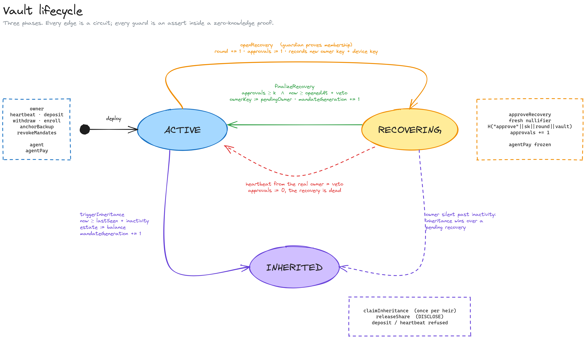
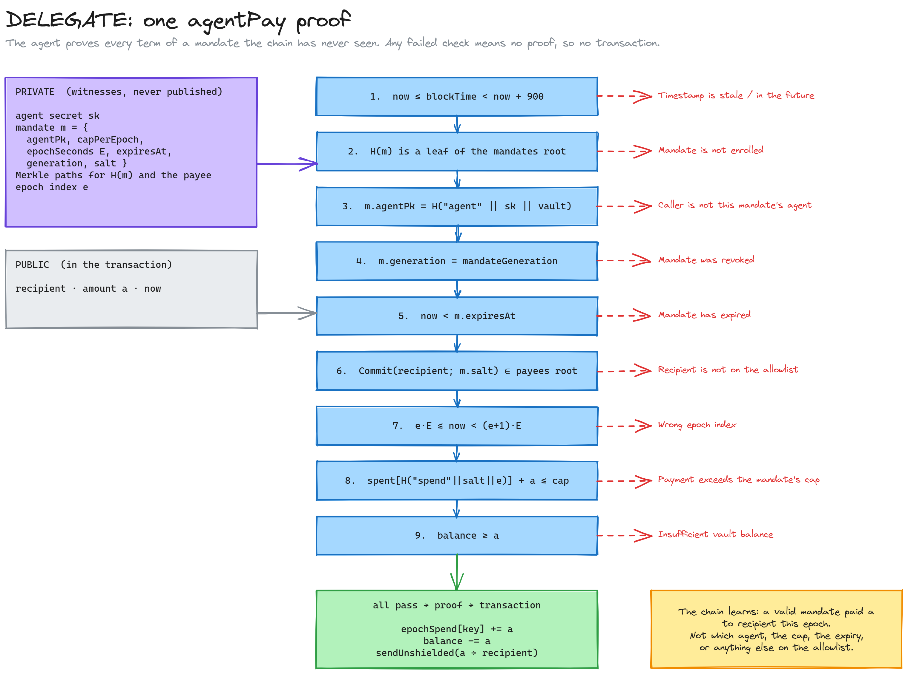
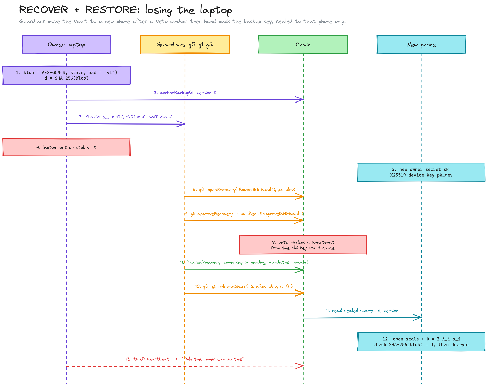
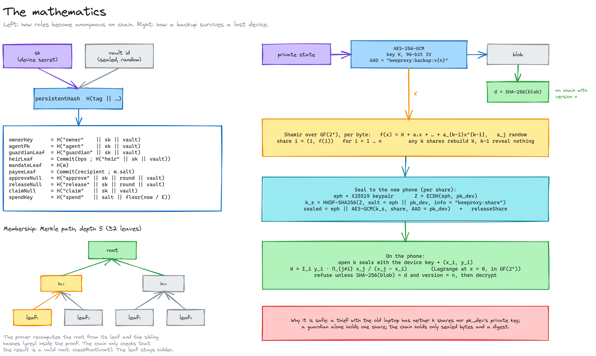

<div align="center">

# keeproxy

**Who can act for you when you can't.**

One Midnight vault that lets your AI agent, your guardians and your heirs act on your behalf,
within limits a zero-knowledge contract enforces, without the chain ever learning who they are.

[](LICENSE)
[](https://midnight.network)
[](contract/proxy.compact)
[](#testing)

**[keeproxy.vercel.app](https://keeproxy.vercel.app)**

[Overview](#overview) ·
[Architecture](#architecture) ·
[Flows](#flows) ·
[Mathematics](#mathematics) ·
[Privacy](#privacy-model) ·
[Quick start](#quick-start) ·
[Testing](#testing) ·
[Repository](#repository)

</div>

---

## Overview

A seed phrase is a single point of failure. Lose the device and the assets are gone; die and nobody can reach them; hand an AI agent your keys and it can spend everything. The usual fixes (multisig, social recovery, a will) each publish your guardians, your heirs and your balances, which is a map for anyone planning to coerce you.

Keeproxy publishes only the **rules**. Every person is a hash of a secret that lives on their own device, and every action is a zero-knowledge proof against a Merkle root. One contract, [`contract/proxy.compact`](contract/proxy.compact), gives the vault five powers:

| Power | What it does | The contract refuses |
|---|---|---|
| **DELEGATE** | An AI agent pays from the vault under a private mandate: a cap per epoch, a payee allowlist, an expiry and a kill switch | over the cap, a recipient not on the allowlist, expired, revoked, forged terms, the wrong agent |
| **RECOVER** | k-of-n anonymous guardians move the vault to a new owner key after a veto window | a non-guardian, a double approval, below threshold, inside the veto window, a recovery vetoed by a heartbeat |
| **RESTORE** | The owner's private state is backed up encrypted, with its digest and version anchored on chain; after a recovery, guardians seal key shares to the new device | a stale or rolled-back backup, a tampered blob, a double share release, the stolen laptop |
| **INHERIT** | After a chosen period of silence, heirs claim private shares of the estate, once each | an owner who is still active, a non-heir, a lied-about share, a double claim, overpaying the estate |
| **DISCLOSE** | Once inherited, guardians release sealed document keys | release before the trigger, a double release |

## Architecture


| Component | Role |
|---|---|
| [`contract/proxy.compact`](contract/proxy.compact) | 13 circuits, Compact 0.36.1 / language 0.28, ledger 9. Witnesses, `MerkleTree<5>` membership, round-scoped nullifiers, salted `persistentCommit`, block-time guards, unshielded NIGHT in and out. |
| [`contract/witnesses.ts`](contract/witnesses.ts) | Each device's private state: its secret, mandate terms or share, plus Merkle paths and the off-chain divisions the circuits check. |
| [`src/vault-service.ts`](src/vault-service.ts) | Runs every action as exactly one device, so a call can only use that device's secret. |
| [`src/restore.ts`](src/restore.ts) | RESTORE crypto: AES-256-GCM backups, Shamir k-of-n over GF(2⁸), X25519 + HKDF sealing. Node's built-in crypto only. |
| [`src/staged-deploy.ts`](src/staged-deploy.ts) | 13 verifier keys do not fit in one block, and ledger 9 refuses blank key slots, so the vault deploys with 4 entry points and inserts the other 9 keys with maintenance transactions. |
| [`server/keeproxyd.ts`](server/keeproxyd.ts) | JSON API, a live event stream, and on-chain receipts (`GET /api/tx/<hash>`) for the console. |
| [`web/`](web) | Landing page and console (React + Vite): a guided three-act walkthrough and an all-devices view. |
| [`agent/mcp-server.ts`](agent/mcp-server.ts) | An MCP server that lets Claude act as the vault's agent, and nothing more. |

### Lifecycle



A recovery can only succeed against an owner who is really gone: any heartbeat during the veto window cancels it. If the owner stays silent past the inactivity period, inheritance can trigger even while a recovery is pending.

## Flows

### Delegate



The owner enrolls only $H(m)$, the hash of the mandate. To pay, the agent proves it knows a mandate whose hash is in the tree, that it holds the mandate's key, and that the payment respects every term. A failed check means no proof can be built, so no transaction ever reaches the chain. The kill switch (`revokeMandates`) bumps `mandateGeneration`, which invalidates every mandate at once.

### Recover and restore



### Inherit and disclose


## Mathematics



### Keys, leaves and nullifiers

Every value bound to a person hashes in the vault's sealed random id $v$, so one secret reused across two vaults yields unlinkable values. $H$ is Compact's `persistentHash` (domain-separated by a 32-byte tag) and $\mathrm{Com}(x; r)$ is `persistentCommit`.

$$
\begin{aligned}
\text{ownerKey} &= H(\texttt{"owner"} \,\|\, sk \,\|\, v) &
\text{guardianLeaf} &= H(\texttt{"guardian"} \,\|\, sk \,\|\, v) \\
\text{agentPk} &= H(\texttt{"agent"} \,\|\, sk \,\|\, v) &
\text{heirLeaf} &= \mathrm{Com}\big(b;\ H(\texttt{"heir"} \,\|\, sk \,\|\, v)\big) \\
\text{mandateLeaf} &= H(m) &
\text{payeeLeaf} &= \mathrm{Com}(\text{recipient};\ m.\text{salt})
\end{aligned}
$$

Repeat actions are stopped with nullifiers. Approval and release nullifiers are scoped to a recovery round $r$, so a guardian can act again in a later round, but never twice in the same one:

$$
N_{\text{approve}} = H(\texttt{"approve"} \,\|\, sk \,\|\, r \,\|\, v), \qquad
N_{\text{release}} = H(\texttt{"release"} \,\|\, sk \,\|\, r \,\|\, v), \qquad
N_{\text{claim}} = H(\texttt{"claim"} \,\|\, sk \,\|\, v)
$$

### Membership

Each role set is a depth-5 Merkle tree (up to 32 members). A member proves $\ell \in T$ by recomputing the root from its leaf and the five sibling hashes $s_i$ on its path, inside the proof (`merkleTreePathRoot`), where $\mathrm{node}$ is the tree's internal hash and the path's direction bits order each pair:

$$
h_0 = \ell, \qquad h_{i+1} = \begin{cases} \mathrm{node}(h_i, s_i) & \text{if } h_i \text{ is a left child} \\ \mathrm{node}(s_i, h_i) & \text{otherwise} \end{cases}, \qquad \texttt{checkRoot}(h_5)
$$

Only $h_5$ is disclosed, and it equals the public root for every member, so the chain learns that *some* guardian acted, never which one.

### Time

The caller supplies `now`, and the circuit pins it to the block clock. Private deadlines (a mandate's expiry, for example) are then compared against `now` inside the proof and never reach the kernel:

$$
\text{now} \le t_{\text{block}} < \text{now} + 900
$$

| Guard | Condition |
|---|---|
| Finalize a recovery | $\text{approvals} \ge k \ \wedge\ \text{now} \ge \text{openedAt} + \text{veto}$ |
| Trigger inheritance | $\text{now} \ge \text{lastSeen} + \text{inactivity}$ |
| Mandate alive | $\text{now} < m.\text{expiresAt} \ \wedge\ m.\text{generation} = \text{mandateGeneration}$ |
| Deploy | $k \ge 1 \ \wedge\ \text{inactivity} > \text{veto}$ |

### Spending cap

Integer division is done off chain by a witness and checked in the circuit. With epoch length $E$ and amount $a$:

$$
e = \left\lfloor \frac{\text{now}}{E} \right\rfloor \quad\text{checked as}\quad eE \le \text{now} < (e+1)E,
\qquad
\text{spent}\big[H(\texttt{"spend"} \,\|\, m.\text{salt} \,\|\, e)\big] + a \le m.\text{cap}
$$

The spend key changes every epoch, so spends in different epochs cannot be linked to each other or to the agent.

### Estate shares

When inheritance triggers, the estate $S$ is frozen. An heir with a private share of $b$ basis points is paid once:

$$
q = \left\lfloor \frac{S \cdot b}{10\,000} \right\rfloor \quad\text{checked as}\quad 10\,000\,q \le S b < 10\,000\,(q+1),
\qquad
\text{estatePaid} + q \le S
$$

Rounding dust stays in the vault, and an owner who over-allocates shares can never cause an overpayment: the claim that would exceed $S$ is refused.

### Backups (RESTORE)

The owner encrypts its private state under a fresh key $K$, binding the version $n$ as associated data, and anchors only the digest:

$$
\text{blob} = \text{AES-256-GCM}_K\big(\text{state};\ \text{IV},\ \text{AAD} = \texttt{"keeproxy:backup:v}n\texttt{"}\big), \qquad d = \text{SHA-256}(\text{blob})
$$

`anchorBackup` requires $n > \text{backupVersion}$, so an old backup can never be passed off as the latest. Restore refuses any blob whose digest or version differs from the ledger before decrypting.

### Key splitting

$K$ is split byte by byte with Shamir's scheme over $\mathrm{GF}(2^8)$ (the AES field, $x^8 + x^4 + x^3 + x + 1$). For each byte, a random polynomial of degree $k-1$ hides it in the constant term:

$$
f(x) = K + a_1 x + \dots + a_{k-1} x^{k-1}, \qquad \text{share}_i = \big(i,\ f(i)\big), \quad i = 1 \dots n
$$

Any $k$ shares rebuild $K$ by Lagrange interpolation at zero; any $k-1$ shares are consistent with every possible $K$:

$$
K = f(0) = \sum_{i \in Q} y_i \prod_{j \in Q,\ j \ne i} \frac{x_j}{x_j - x_i}
$$

### Sealing shares to the new device

`openRecovery` publishes the new device's X25519 key $P$. Each guardian seals its share with an ephemeral key pair $(e, E)$:

$$
Z = \text{X25519}(e, P), \qquad
k_s = \text{HKDF-SHA256}\big(Z;\ \text{salt} = E \,\|\, P,\ \text{info} = \texttt{"keeproxy:share"}\big), \qquad
\text{sealed} = E \,\|\, \text{AES-GCM}_{k_s}(\text{share};\ \text{AAD} = P)
$$

Only the holder of $P$'s private key can open it. A thief with the old laptop has neither $k$ shares nor that key.

## Privacy model

| | On chain | Never on chain |
|---|---|---|
| Owner | hash of the secret, last heartbeat | the secret, the wallet |
| Agent | hash of the mandate, spend per epoch | agent identity, cap, expiry, allowlist |
| Guardians | Merkle root, per-round nullifiers | who they are, who approved |
| Heirs | Merkle root, claim nullifiers | who they are, shares (until claimed) |
| Backups | SHA-256 digest, version, sealed shares | contents, key, plain shares |

**Accepted leaks**, listed in [`docs/SPEC.md`](docs/SPEC.md):
- the vault's rules and NIGHT balance
- which circuit ran
- the amount and recipient of each unshielded payment
- an heir's share, revealed by the payout when they claim

The in-memory tests enforce the "never on chain" column by walking the entire public ledger for every secret.

## Quick start

**Requirements:** Node 22, Docker. Windows has no native Compact 0.36.1 toolchain, so on Windows build the compiler image once:

```bash
bash scripts/setup-compactc.sh
```

```bash
npm install
npm run compile:fast        # contract → JS in seconds, enough for the in-memory tests
npm run test:sim            # 85 in-memory tests
npm run compile             # full compile with proving and verifier keys (needed for the devnet)
npm run env:up              # local Midnight node, indexer and proof server (compose.yml)
npm run test:local          # devnet end-to-end: real proofs, all five powers
```

### Console

```bash
npm run build:web
npm run serve               # http://127.0.0.1:8787  (landing page and #/console)
```

The console deploys a vault and walks you through three acts (Delegate, Recover & restore, Inherit) one step at a time. Each step runs as exactly one device and says in advance whether the contract should accept or refuse it. The **All devices** view exposes every action at once, and **what the chain sees** updates live from the indexer.

### Proving each transaction

Every confirmed step has a **view proof** button. The receipt is rebuilt from the indexer, not from keeproxyd's memory, and shows:
- the block that included the transaction, and its status
- the circuit it called on this vault
- the zero-knowledge proof inside the raw transaction, which the node verified against the contract's on-chain key before accepting it
- any NIGHT paid out

A copyable `curl` command lets anyone ask the indexer directly. From a terminal: `npm run receipt -- <tx hash>`. A refused step has no transaction: the contract's check fails while the proof is built, so nothing reaches the chain.

### Claude as the agent (MCP)

```bash
npm run serve               # keep running
claude mcp add keeproxy -- npm run agent:mcp --prefix <path-to-keeproxy>
```

Tools: `vault_status`, `pay`, `request_limit_raise`. The agent can only pay under its mandate. It cannot heartbeat, withdraw, recover or raise its own cap, because it holds no secret that proves any of that.

### Preprod

Copy `.env.preprod.example` to `.env.preprod`, add a Blockfrost project ID and a wallet funded from the faucet, then run `MIDNIGHT_NETWORK=preprod npm run deploy`. The address lands in `deployments/preprod.json`.

**Live on preprod:** [`79b8e465…7a4a`](deployments/preprod.json) (deploy and 9 verifier-key transactions), watched at [keeproxy.vercel.app/#/console](https://keeproxy.vercel.app/#/console).

A new wallet's first preprod sync replays the chain's shielded and DUST events (about 2 million of each). The DUST sync starts at the ledger-9 boundary ([src/dust-boundary.ts](src/dust-boundary.ts)), because the SDK's own search for that boundary comes back empty against Blockfrost. Progress is checkpointed to `.wallet-state/` every five minutes, so an interrupted sync resumes; a first sync takes about an hour and a half.

### Hosted watch mode

| Piece | Where | Holds |
|---|---|---|
| Website and console UI | Vercel ([keeproxy.vercel.app](https://keeproxy.vercel.app), root `web/`) | nothing |
| `keeproxy-viewer` ([server/viewer.ts](server/viewer.ts)) | Railway | no keys, no wallet, no private state |

The hosted console cannot act. It shows a live vault read from the indexer: what the chain sees, every call in its history, and a receipt with the proof for each one. All actions still run on the devices that hold the secrets: `keeproxyd` locally, or the MCP agent. The viewer answers every write with `405`.

```bash
npm run compile:fast && bash scripts/stage-viewer.sh
cd .deploy/viewer && railway up            # Dockerfile + railway.json
railway variables --set MIDNIGHT_NETWORK=preprod --set BLOCKFROST_PROJECT_ID=… --set KEEPROXY_ADDRESS=<contract>
```

The web build reads the viewer's URL from `VITE_KEEPROXY_API`. The Blockfrost project ID is stripped from everything the viewer returns. Until `KEEPROXY_ADDRESS` is set, the hosted console shows the run-it-yourself steps.

## Testing

| Suite | Command | Tests | What it covers |
|---|---|---|---|
| Contract guards | `npm run test:sim` | 38 | every assert in every circuit, the five powers, privacy invariants |
| Scenarios | `npm run test:sim` | 20 | multi-step stories, exact boundaries, estate arithmetic, unlinkability |
| Crypto and receipts | `npm run test:sim` | 27 | Shamir, backups, sealing, and decoding a real devnet transaction |
| Devnet end to end | `npm run test:local` | 8 | real proofs on a local Midnight network, all five powers |

The in-memory suites run the compiler's JavaScript output against `compact-runtime` with a controllable block clock: no network, no proofs, about 30 seconds.

<details>
<summary><b>Scenarios covered</b></summary>

- **One vault, a whole life.** The agent spends across two epochs, the owner backs up and loses the laptop, two guardians recover to a new phone, and the stolen laptop is refused by every owner circuit. The phone restores and re-anchors v2 (v1 is now stale) and issues a fresh mandate. Then it goes silent; both heirs claim and the estate is paid out exactly. A guardian then discloses in its own round.
- **Hostile takeover.** Colluding guardians reach the threshold three rounds in a row; a live owner vetoes each with one heartbeat, and nothing moves. One guardian cannot approve twice to fake a quorum.
- **The owner dies mid-recovery.** Inheritance triggers while a recovery is open, and the pending recovery can no longer finalize.
- **Exact boundaries.** For each timer and limit, the test runs one second (or one unit) before and exactly at the edge:
  - finalize at the end of the veto window
  - trigger at the end of the inactivity period
  - a mandate's last valid second
  - the full cap at an epoch boundary
  - the 900-second timestamp window
  - zero amounts
  - deposits and withdrawals while a recovery is open
- **Estate arithmetic.** Floor rounding with three heirs (1001 → 333 × 3, dust 2), a single heir at 100%, over-allocated shares that can never overpay, a dust-sized share, and a lying witness that tries to inflate its payout.
- **Unlinkability.** One guardian or heir secret in two vaults gives different leaves and nullifiers; spend keys differ per epoch.
- **Crypto properties.**
  - every k-subset of every (k, n) scheme rebuilds the secret, and k−1 shares never do
  - backups from 0 bytes to 1 MB round-trip
  - every single-bit flip is refused
  - a v1 blob relabelled as v2 does not decrypt
  - seals open only on their device, and two seals of one share are unlinkable
- **Receipts.** A real `agentPay` transaction captured from the devnet decodes to its block, circuit, 5.3 KB proof and payout. Unknown hashes, indexer errors, malformed hashes and proof-erased transactions are all refused.

</details>

## Repository

```
contract/            proxy.compact (13 circuits), witnesses.ts, index.ts
src/                 vault-service, staged-deploy, restore crypto, tx-receipt, providers / wallet / config
src/test/            *.sim.test.ts (in memory), keeproxy.test.ts (devnet), world.ts (fixtures)
server/              keeproxyd: JSON API, event stream, receipts, static web
agent/               MCP server (Claude as the vault's agent)
web/                 landing page and console (React, Vite)
docs/SPEC.md         every ledger field, guard, privacy invariant and accepted leak
docs/diagrams/       Excalidraw sources (.excalidraw) and rendered PNGs
scripts/             deploy, receipt, render-diagrams, compactc wrapper
```

The diagrams are generated from [`docs/diagrams/build.mjs`](docs/diagrams/build.mjs). Open any `.excalidraw` file at [excalidraw.com](https://excalidraw.com) to edit it, or change the layout and run `npm run diagrams`, then open the printed local URL to re-render the PNGs.

## Roadmap

- Shielded payouts, hiding amounts and recipients.
- An SDK wrapper that restores other Midnight dApps' private state through the same backup path.
- Revoking one mandate without revoking all.
- Decoy vaults for coercion resistance.

## Credits

The wallet and provider harness and the in-memory simulator are adapted from [midnightntwrk/midnight-examples](https://github.com/midnightntwrk/midnight-examples) (Apache-2.0). Staged deployment follows the approach documented by Stock & Foil. Fonts: Geist, Geist Mono and Geist Pixel (SIL OFL). Diagrams are drawn with [Excalidraw](https://excalidraw.com).

## License

[Apache-2.0](LICENSE)
